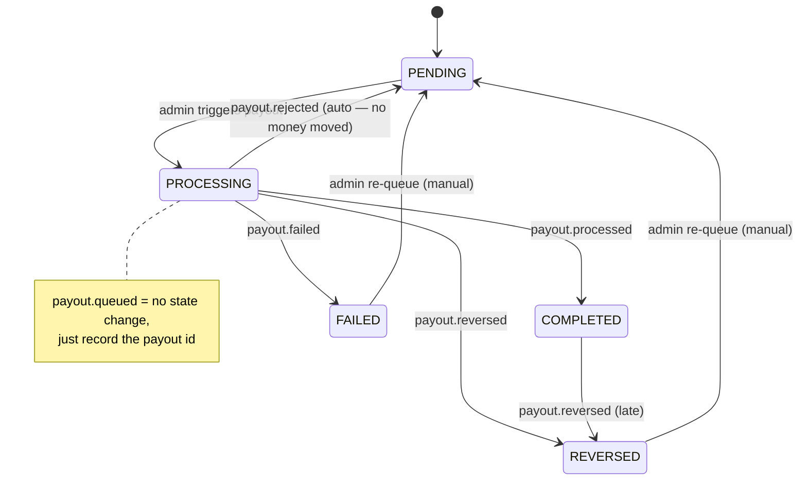

# Provider Payout Settlement — State Machine

Tracks a booking's `settlement_status` (the provider-payout lifecycle), which is
separate from `payment_status` (customer collection) and `status` (fulfilment).

Money is collected from the customer to the platform account up front; the
provider's share is paid out separately via RazorpayX. This document describes how
a booking moves through the payout lifecycle.

## States

| State | Meaning |
|---|---|
| `PENDING` | Completed booking, provider's share not yet paid. Eligible for the next payout run. |
| `PROCESSING` | A RazorpayX payout has been created for this booking; awaiting a terminal webhook. |
| `COMPLETED` | Payout succeeded (`payout.processed`). |
| `FAILED` | Payout attempt failed and money *may* have moved (`payout.failed`). **Manual** admin re-queue only. |
| `REVERSED` | Payout completed, then clawed back by the bank / RazorpayX (`payout.reversed`). Needs investigation. |

## Transitions

| From | Trigger | To | Notes |
|---|---|---|---|
| `PENDING` | admin triggers payout | `PROCESSING` | `create_provider_payout` |
| `PROCESSING` | `payout.queued` | *(no change)* | RazorpayX accepted, not yet sent; records `settlement_payout_id` if missing |
| `PROCESSING` | `payout.processed` | `COMPLETED` | payout succeeded |
| `PROCESSING` | `payout.failed` | `FAILED` | money may have moved → manual re-queue; `failure_reason` recorded |
| `PROCESSING` | `payout.rejected` | `PENDING` | **no money moved** → auto-retryable (RazorpayX sends no reason here) |
| `PROCESSING` / `COMPLETED` | `payout.reversed` | `REVERSED` | completed money clawed back → alert |
| `FAILED` | admin re-queue (`requeue_settlements`) | `PENDING` | manual |
| `REVERSED` | admin re-queue (`requeue_settlements`) | `PENDING` | manual |

## Diagram

## Two routes back to `PENDING`

A booking can return to `PENDING` (and be re-picked by the next payout run) in two
distinct ways — and the distinction is a safety one:

- **Automatic — `payout.rejected`.** RazorpayX refused the payout before sending, so
  **nothing left the platform account**. Re-trying is risk-free, so the booking is
  returned to `PENDING` automatically and the rejection reason is stored in
  `settlement_failure_reason`.
- **Manual — admin re-queue of `FAILED` / `REVERSED`.** Here money *may* have moved
  (failed) or *did* move and came back (reversed). Blindly retrying risks paying the
  provider twice, so a human must confirm before re-queuing (`requeue_settlements`,
  admin-only, audited).

## `settlement_failure_reason`

Records why the most recent payout attempt didn't succeed. It is populated from the
RazorpayX payout's `failure_reason` (falling back to the `error` object; forward-
compatible with the newer `status_details`). In practice the meaningful string comes
on **`payout.failed`** — RazorpayX does *not* provide a reason for `payout.rejected`
(that field is null), so a rejection usually leaves it empty.

It stays visible while the booking waits in `PENDING`/`FAILED` (so an admin can see
why before deciding to re-queue a `FAILED` settlement), and is **cleared
automatically when the next attempt begins** (`create_provider_payout`, on the flip
to `PROCESSING`). So it always reflects the current cycle — empty while an attempt is
in flight or the last one succeeded.

## Reconciliation

Webhooks can be dropped or delayed. A nightly reconciliation cron
(`reconcile_payouts`) reads RazorpayX's record of payouts and repairs drift:
bookings stuck in `PROCESSING` from a missed webhook, and orphaned payouts from the
create-path dual-write gap. Anything it can't resolve is alerted for manual review.
